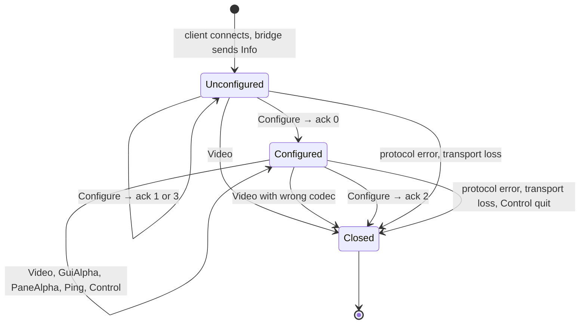
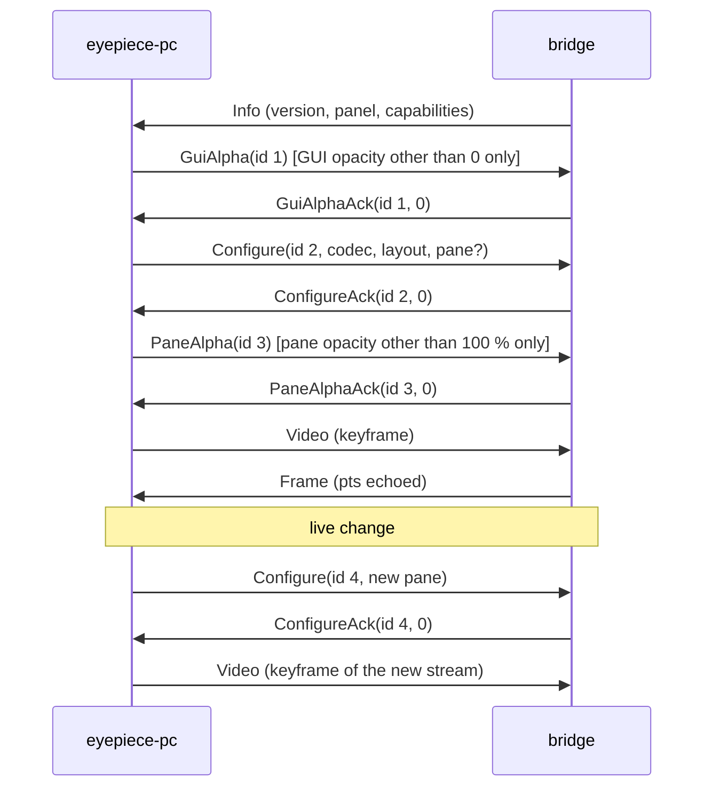

# Bridge protocol (PC ↔ goggles)

The bridge protocol connects `eyepiece-pc` to the bridge on the goggles (`pcdisplay_bridge` of tinkerglass's PC Display mod; the natartos-era `eyepiece_bridge` speaks the same protocol). It
carries encoded video to the goggles and head pose, timing and display
feedback back. This page is the behavioural specification;
[`contract/eyepiece-rpc.proto`](../../contract/eyepiece-rpc.proto) is the canonical
schema and is compiled into both ends (prost on the PC, nanopb on the bridge).

The same schema also carries the [RPC protocol](rpc.md) between `eyepiece-pc` and
the web UI. Both protocols share the `Envelope` message and its tag space, but
they never mix on one connection.

**Current version: 4.** It is incompatible with every earlier version. Update the
PC, the web UI and the bridge together; the PC refuses a bridge whose `Info.version`
differs from its own.

- [Transports and framing](#transports-and-framing)
- [Messages](#messages)
- [Connection state machine](#connection-state-machine)
- [Configure](#configure)
- [Video](#video)
- [Opacity](#opacity)
- [Telemetry and clock sync](#telemetry-and-clock-sync)
- [Capabilities](#capabilities)
- [Errors](#errors)
- [Example session](#example-session)
- [Evolution rules and history](#evolution-rules-and-history)

## Transports and framing

One bridge serves one client at a time over either transport. Both carry the identical
byte stream.

| Transport | Address | Notes |
|---|---|---|
| TCP | `127.0.0.1:42420` on the goggles | Reached through `adb forward tcp:42420 tcp:42420`, the default. `-A` listens on all interfaces for a directly reachable bridge (`--host`). |
| USB bulk | vendor interface of the goggles' USB mode | tinkerglass: interface class/subclass/protocol `ff/54/03` ("tinkerglass video"), one bulk OUT and one bulk IN endpoint, no bridge option; the natartos bridge used its own `ffs.eyepiece` interface with `-B`. See [transports](../transports.md). |

Every record is:

```
+----------------------+---------------------------+
| length: u32, big-end | Envelope (protobuf bytes) |
+----------------------+---------------------------+
```

- `length` counts only the Envelope bytes, not itself.
- The encoded Envelope is limited to **4 MiB** (`EP_MAX_PAYLOAD`).
- A zero length, an oversized length, a truncated record, malformed protobuf, or an
  Envelope with no recognised message is a protocol error (see [Errors](#errors)).

```proto
message Envelope {
  optional string id        = 1;   // correlation ID
  optional string sender    = 2;   // informational, never routed
  optional string recipient = 3;   // informational, never routed
  oneof message { ... }            // exactly one is required
}
```

**Correlation IDs.** Requests that expect an acknowledgement (`configure`,
`gui_alpha`, `pane_alpha`) carry a canonical unsigned 32-bit decimal in
`Envelope.id`: digits only, no leading zeroes except `"0"`, at most 10 digits,
value ≤ 4294967295. The acknowledgement copies the ID verbatim. A request with a
missing or non-canonical ID is a protocol error. The PC allocates IDs from separate
counters for Configure and for the opacity requests, and has at most one Configure and
one opacity request in flight. All other messages omit the ID.

## Messages

Tags are permanent and are shared with the [RPC protocol](rpc.md).

### PC → goggles

| Message | Tag | Purpose | Ack |
|---|---:|---|---|
| `Configure` | 65 | Define or replace the video stream: codec, layout, optional pane. | `ConfigureAck` |
| `Video` | 50 | One Annex-B access unit. | frame reports |
| `GuiAlpha` | 56 | DJI GUI plane opacity, 0–255. | `GuiAlphaAck` |
| `PaneAlpha` | 63 | GFX1 pane opacity, 0–255. | `PaneAlphaAck` |
| `Ping` | 51 | Clock-sync probe carrying the PC timestamp. | `Pong` |
| `Control` | 52 | Recenter, quit, head tracking on or off. | none |

### Goggles → PC

| Message | Tag | Purpose |
|---|---:|---|
| `Info` | 59 | Sent once, immediately after the client connects: version, panel, capabilities. |
| `ConfigureAck` | 66 | Status of a `Configure`. |
| `GuiAlphaAck` | 62 | Status of a `GuiAlpha`. |
| `PaneAlphaAck` | 64 | Status of a `PaneAlpha`. |
| `Frame` | 58 | Timing and queue report for each frame that reached the display. |
| `Pose` | 33 | Head orientation sample, 100 Hz while tracking is enabled. |
| `Pong` | 57 | Reply to `Ping`. |
| `Log` | 32 | Diagnostic text; also used as a keyframe hint. |
| `KeyRequest` | 60 | Reserved for explicit keyframe requests; no bridge sends it yet. |

Messages of the other protocol (the RPC commands and replies) are protocol errors on
a bridge connection, and so are the bridge-only messages on an RPC connection.

## Connection state machine

A connection has no stream until a `Configure` has been acknowledged. There is no
separate "pane" or "stream" negotiation step: `Configure` is the single message that
describes the stream, both the first time and every time it changes.



| State | Accepts | On anything else |
|---|---|---|
| Unconfigured | `Configure`, `GuiAlpha`, `PaneAlpha` (acked 2 until a pane exists), `Ping`, `Control` | `Video` closes the connection |
| Configured | everything above, plus `Video` whose codec equals the active codec | `Video` with another codec closes the connection |
| Closed | nothing | the bridge drops the queue and returns to waiting for a client |

The bridge process outlives connections. What survives a disconnect depends on how it
was started:

| Started with | After the client disconnects |
|---|---|
| `-1` | the bridge exits |
| `-b` only (menu launch) | the bridge keeps running and waits. A decoder that is already open on VIDEO0 stays open, so the next client must send the same configuration (anything else is status 3). GFX1 is unavailable in this mode. |

Nothing of a connection is kept for the next one: the stream, the pane and the GUI opacity end with it.

### PC view

`Link::configure` is the only way to send video. The link refuses `send_video` until a
`Configure` is acknowledged with status 0, and again after any failure or when a
replacement is in flight. A rejected replacement (status 1 or 3) restores the previous
configured state.



## Configure

```proto
message Configure {
  uint32 codec  = 1;          // 0 H.264, 1 HEVC
  uint32 layout = 2;          // 0 mono, 1 side-by-side stereo
  optional Pane pane = 3;     // absent: full panel on VIDEO0; present: GFX1 overlay
}

message Pane {
  uint32 x = 1;  uint32 y = 2;          // panel pixels
  uint32 width = 3;  uint32 height = 4; // panel pixels, even
  uint32 format = 5;                    // 1 packed alpha, 2 opaque; 0 (NV12) reserved
}
```

`Configure` carries no width, height or frame rate. The encoded frame size is derived
from the other fields and both ends compute it the same way:

| `pane` | `layout` | Encoded frame size | Display path |
|---|---|---|---|
| absent | mono | panel size, 1920×1080 | VIDEO0 plane |
| absent | stereo | 2560×720 (two 1280×720 eyes) | VIDEO0 on both VOPs, 3D timing |
| present, `format = 2` | mono | pane `width × height` | GFX1, decoder NV12 scanned out directly |
| present, `format = 1` | mono | `2·width × height`, colour left, alpha right | GFX1, BGRA reconstructed on the goggles |

The goggles have no display scaler, so the PC scales everything to these sizes. A pane
cannot be combined with stereo.

### Validation

The bridge validates the complete request before any side effect.

Status **1, invalid**, nothing changed:

- `codec > 1` or `layout > 1`;
- a pane with stereo layout;
- a pane format other than 1 or 2;
- a pane with zero or odd width or height, or one that does not fit the panel
  (`x + width > panel width`, `y + height > panel height`);
- a packed-alpha pane whose doubled width exceeds 65535.

Status **3, unsupported**, nothing changed:

- the bridge runs without video (`-V`);
- a pane is requested but the bridge is not in a GFX1-capable mode (it needs
  `-1`, hardware decode on VOP0, a 1920×1080 panel and no stereo override), or
  `dji_arhome` could not be stopped for GFX1;
- stereo is requested but the bridge has no direct VOP output;
- a decoder on the VIDEO0 plane is already open and the request differs from the active
  configuration.

The PC performs the same checks against `Info` before sending, so a well-behaved
client sees status 1 or 3 only from races and from VIDEO0 replacement.

### Applying a request

When the request is valid, the bridge hands it to the decoder thread, which owns the
decoder, and waits for the result. The outcome depends on what is already running:

| Active decoder | Request | Result |
|---|---|---|
| none yet | anything valid | status 0; the decoder opens on the first keyframe that follows |
| any | identical to the active configuration | status 0; a keyframe is required again (the "resume" operation) |
| GFX1 pane | same codec, layout, pane size and format; only `x`, `y` differ | status 0; the plane is moved, the decoder keeps running |
| GFX1 pane | any other change, including dropping the pane | the decoder is drained and released; status 0; the next keyframe opens the new decoder |
| GFX1 pane | the pane cannot be moved or the decoder released | status 2 |
| VIDEO0 | anything but identical | status 3; VIDEO0 decoders are kept until the bridge exits |

Status **2, failed**: the decoder or its display resources could not be moved or
released. Those resources are then held until the process exits, so the bridge ends
the connection and **exits**. A failure to *open* a new decoder does not use status 2:
that happens on the first keyframe after the acknowledgement, and it closes only the
connection (the bridge logs `hwdec: cannot open decoder`).

On every status-0 acknowledgement the bridge discards queued video and waits for a
keyframe. A client must therefore:

1. stop sending video of the old stream before it sends `Configure`;
2. send no video until the acknowledgement arrives;
3. start the new stream with a keyframe.

Opacity values are **not** affected by `Configure`; see [Opacity](#opacity).

### The PC side

`eyepiece-pc` builds one `StreamConfig` for the session and sends it at connect and on
every live pane change. It currently always configures a pane (the whole panel, opaque, by
default); the no-pane and stereo forms are part of the protocol for other clients. A reconnect starts a new
connection and sends it again. A live change makes the encoder and the bridge switch together:

1. the capture stage prepares the new converter and a first frame;
2. the encode stage opens the new encoder and calls `configure` (5 s timeout);
3. on status 0 it requests an IDR, resets its pending-frame bookkeeping and flags a
   preview discontinuity; on status 1 or 3 it keeps the old encoder and stream;
4. on status 2, a timeout or a transport error, the link is closed.

## Video

```proto
message Video {
  uint64 pts_us = 1;        // PC monotonic capture time
  uint32 codec = 2;         // must equal the active Configure codec
  bool   key = 3;
  bytes  access_unit = 4;   // one non-empty Annex-B access unit
}
```

- The envelope tag is 50. The access unit is the last field of `Video`, so the PC can
  write the length and protobuf prefixes and the access unit with one vectored write
  and no copy; the bridge decodes with the access unit borrowed from the receive buffer.
- `pts_us` is opaque to the bridge. It echoes it in `Frame.pts_us`, and the PC uses it
  to compute capture-to-display latency.
- Video before an acknowledged `Configure`, a zero-length access unit or a codec that is
  not 0 or 1 is a protocol error; a codec other than the active one closes the connection.
- The bridge queues up to 16 access units. Until a keyframe has been received after
  connect, a `Configure` or a resync, non-key access units are dropped. A keyframe
  clears everything queued before it. On overflow the queue is dropped and the bridge
  logs `decode queue overflow → waiting for next keyframe`.
- The decoder opens on a keyframe; non-key access units are dropped while it is closed.
- A submit failure resynchronises the same way.

### Keyframe requests

The PC sends a keyframe: at connect and after every `Configure`; when a `Log` message
contains `keyframe` or `overflow`; when a `KeyRequest` arrives; when it has sent at
least four access units, the first more than 200 ms ago, and received no `Frame`; and
on demand from the user or RPC. Requests are rate-limited to one per 250 ms.

## Opacity

Two independent opacities exist, both acknowledged and both with an ID.

```proto
message GuiAlpha  { uint32 alpha = 2; }   // 0..255, the goggles' UI (GUI plane)
message PaneAlpha { uint32 alpha = 1; }   // 0..255, GFX1 pane
message Acknowledgement { uint32 status = 2; }
```

| Request | 0 | 1 | 2 |
|---|---|---|---|
| `GuiAlpha` | applied | alpha > 255 | the bridge holds no display lease (`-V`), or the display service refused it |
| `PaneAlpha` | applied | alpha > 255 | no pane is active, or the display refused it |

- `GuiAlpha` needs `CAPABILITY_GUI_ALPHA`. A connection starts at 0: the goggles' UI is hidden and gets no
  buttons. Above 0, tinkerglass's display service shows the UI at that opacity above the video and the pane, and
  the UI gets the buttons except the ones the bridge uses while no UI menu is open (OK recenters head tracking;
  Back ends a bridge started from the menu). It is acknowledged after the display service applied it. The PC
  sends it only for an opacity other than 0.
- `PaneAlpha` needs `CAPABILITY_PANE_ALPHA`. It multiplies decoded pixel alpha by
  `alpha / 255`, with rounding. For opaque panes it is the hardware global alpha; for
  packed alpha it multiplies the reconstructed per-pixel alpha. It applies to the frame on
  screen and to future frames without restarting the decoder.
- A `PaneAlpha` sent while the connection is unconfigured, or while the active
  configuration has no pane, is acknowledged with status 2.
- The accepted pane opacity is **kept across `Configure`** within a connection. A connection
  starts fully opaque; the PC sends another value right after the first acknowledged
  `Configure` that has a pane.
- Both opacities end with the connection.

## Telemetry and clock sync

### Info

```proto
message Info {
  uint32 version = 1;            // 4
  uint32 framebuffer_width = 2;  // panel pixels
  uint32 framebuffer_height = 3;
  uint32 decoder = 4;            // 0 none, 1 software, 2 hardware
  uint32 headtrack = 5;          // bit 0: MCU pose has been received
  uint32 flags = 6;              // capabilities
}
```

`Info` is the first message from the bridge. The PC waits up to 2 s for it and rejects
a mismatched `version`. Capability checks are made against `flags`; see
[Capabilities](#capabilities).

### Pose

`Pose{yaw, pitch, roll, device_us, active, source}`: degrees, positive yaw right,
positive pitch up, positive roll with the right ear down. `device_us` is the goggles'
monotonic clock, not wall time. `source` 3 is the goggles' MCU. Pose flows only while
head tracking is enabled via `Control`; see [head tracking](../head-tracking.md).

### Ping, pong and clock offset

The PC sends `Ping{pc_us}` every 150 ms for the first 8 probes and then once a second.
The bridge replies `Pong{pc_us (echoed), device_us}`. For each pong:

```
rtt    = pc_now - pc_us
offset = device_us - (pc_us + rtt / 2)        # goggles clock minus PC clock
```

The PC keeps the last 16 samples and uses the offset of the sample with the lowest RTT.
This tracks drift without trusting outliers.

### Frame reports

`Frame{pts_us, received_us, shown_us, decode_us, convert_us, queue_depth, dropped}`:
one per frame that reached the display, **not** per access unit. `pts_us` echoes the
video; `received_us` is when the bridge finished receiving it and `shown_us` when it was
submitted to the display, both on the goggles' clock. `decode_us` and `convert_us` are
durations; `queue_depth` is the decode queue length and `dropped` the cumulative count of
access units the bridge dropped. With the clock offset the PC derives:

| Metric | Definition |
|---|---|
| capture → shown | `shown_us − offset − pts_us` |
| capture → received | `received_us − offset − pts_us` |

"Shown" means submitted to the display, not physical scan-out.

### Control

| `operation` | Value | Effect |
|---|---:|---|
| `CONTROL_RECENTER` | 1 | Reset yaw to the current head direction. |
| `CONTROL_QUIT` | 2 | The bridge exits. |
| `CONTROL_HEADTRACK` | 3 | `enabled` turns the MCU attitude stream on or off; turning it on also recentres. |

Unknown operations are ignored. Head tracking is off until a client enables it, and the
bridge stops the stream when the client disconnects.

### Log

`Log{line}` carries the bridge's diagnostic text. The PC prints each line prefixed with
`goggles:`. It is intentionally not a stable interface, apart from the two keyframe
hints named under [Keyframe requests](#keyframe-requests).

## Capabilities

`Info.flags` is a 32-bit bit set. Always check a capability before using the feature
it names; the PC does.

| Flag | Value | Meaning |
|---|---:|---|
| `CAPABILITY_STEREO` | `0x001` | Side-by-side stereo layout is possible now: direct VOP output, and no mono decoder open yet (a menu-started bridge has one for its waiting screen). |
| `CAPABILITY_PANE_BGRA` | `0x004` | Packed-alpha pane (`format 1`). |
| `CAPABILITY_PANE_OPAQUE_BGRA` | `0x008` | Opaque pane (`format 2`). |
| `CAPABILITY_RECONFIG` | `0x020` | A later `Configure` may replace a running GFX1 stream. Without it, only the first `Configure` of a connection is accepted by the PC. |
| `CAPABILITY_GUI_ALPHA` | `0x040` | `GuiAlpha` is supported (the bridge holds tinkerglass's display lease). |
| `CAPABILITY_PANE_ALPHA` | `0x100` | `PaneAlpha` is supported. |

Values `0x002`, `0x010` and `0x080` were used by earlier drafts (NV12 panes, panes kept across clients, a kept GUI
opacity) and must not be reused.

The bridge sets the pane flags together with `RECONFIG` and `PANE_ALPHA` only in a mode
that can host GFX1. Flags above `0xff` were introduced after the first protocol version,
and PC builds older than that reject them.

## Errors

| Situation | Bridge behaviour |
|---|---|
| Bad length, bad protobuf, non-canonical ID on a request that needs one, unknown or RPC-only message | logs `protocol: …` and **drops the client**; the bridge keeps running |
| `Video` before an acknowledged `Configure`, wrong codec, or empty | logs the mismatch and closes the connection |
| `Configure` status 1 or 3 | acknowledged; active stream unchanged; connection stays open |
| `Configure` status 2 | acknowledged, then the connection closes and the bridge exits |
| Decoder open failure after an acknowledged `Configure` | closes the connection; a later `Configure` retries |
| Display failure while streaming, or 30 consecutive display rejections | the bridge logs it, closes the connection and exits; an isolated rejection only drops the frame |
| Transport loss | the connection ends and releases the display |

There is no error message in this protocol. Anything the PC must act on is a status code
in an acknowledgement or a closed connection.

## Example session

```text
bridge → Info{version 4, 1920×1080, hw decoder, flags 0x16d}
pc     → GuiAlpha{128}            id 1
bridge → GuiAlphaAck{0}           id 1
pc     → Configure{h264, mono, pane{100,50,640,480,format 2}}   id 2
bridge → ConfigureAck{0}          id 2
pc     → PaneAlpha{255}           id 3
bridge → PaneAlphaAck{0}          id 3
pc     → Video{pts 0, key}        …
bridge → Frame{pts 0, …}          …
   (user drags the pane)
pc     → Configure{h264, mono, pane{300,200,640,480,format 2}}  id 4
bridge → ConfigureAck{0}          id 4   (plane moved, decoder kept)
pc     → Video{key}               …
```

## Evolution rules and history

- Field numbers are permanent. Never reuse a removed number or name; reserve it.
- Receivers ignore unknown fields inside a known message and reject an Envelope with
  only unknown content.
- Add new top-level messages only when both peers can be upgraded together.
- Bump `EP_VERSION` (in `proto.rs` and `bridge.h`) for any change that breaks
  an older peer.

| Version | Change |
|---|---|
| 4 | `Stream`, `Pane` and `Reconfigure` (tags 53, 54, 55) and `ReconfigureAck` (tag 61) are removed and reserved, replaced by `Configure` (65) and `ConfigureAck` (66). Frame dimensions and `fps` are no longer sent. The bridge refuses video before an acknowledged `Configure`. Status 3 is added. |
| 3 | Protobuf `Envelope` framing with the bridge messages and the RPC messages in one schema. |
