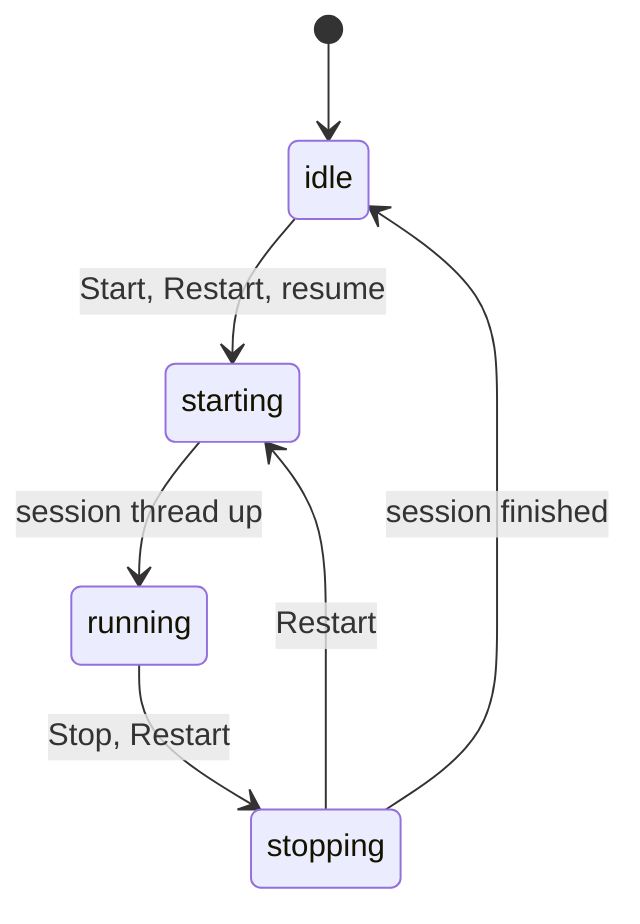

# RPC protocol (web UI ↔ eyepiece-pc)

The RPC protocol lets a client read and change `eyepiece-pc` settings, control the
streaming session, and receive telemetry, head pose and an encoded preview. The built-in
web UI is the main client; any program can use it through a WebSocket or through
stdin/stdout.

It uses the same `Envelope` and the same schema file as the [bridge protocol](bridge.md),
[`contract/eyepiece-rpc.proto`](../../contract/eyepiece-rpc.proto). Settings are defined
separately in [`contract/settings.json`](../../contract/settings.json).

- [Transports](#transports)
- [Framing and IDs](#framing-and-ids)
- [Commands and replies](#commands-and-replies)
- [State and settings](#state-and-settings)
- [Session phases and live updates](#session-phases-and-live-updates)
- [Telemetry](#telemetry)
- [Preview](#preview)
- [Security](#security)

## Transports

| Mode | Start | Notes |
|---|---|---|
| WebSocket | `eyepiece-pc --web` | Serves the static web app on `http://127.0.0.1:4174/` (`EYEPIECE_PORT` changes the port) and the RPC at `/api/rpc`. |
| stdio | `eyepiece-pc --rpc` | Binary frames on stdin and stdout; no HTTP server. |

WebSocket connection:

1. `GET /api/session` returns `{"token": "<random hex>", "workerStatus": "running"}`.
   The token is random per process.
2. `GET /api/rpc?token=<token>` upgrades to a WebSocket.
3. Every message in both directions is a **binary** message holding exactly one record.
   Text messages close the connection.

## Framing and IDs

A record is a four-byte big-endian length followed by one serialized `Envelope`, as in the
bridge protocol. Differences:

- The limit is **8 MiB** per envelope (the bridge limit is 4 MiB).
- A WebSocket binary message holds exactly one record.
- A request needs a nonempty UTF-8 `Envelope.id` of at most 256 bytes. The reply copies
  it. Events that were not requested (log, pose, metrics, preview, and state changes
  broadcast to every client) omit the ID.
- A malformed frame, a bad length, an empty ID or a non-RPC message closes the connection
  (WebSocket) without a reply.

Several WebSocket clients may connect at once. The server prefixes each client's IDs
internally, so IDs only need to be unique per client. A client that cannot keep up with
the broadcast queue is disconnected, and a client's request queue is bounded (16).

## Commands and replies

Every command gets exactly one reply carrying the request ID: `State` on success, or
`Error` on failure, except where the table names a different reply.

| Command | Tag | Effect | Success reply |
|---|---:|---|---|
| `GetState` | 10 | Return the current settings and session state. | `State` |
| `SetProperties` | 11 | Apply a list of `Property` values atomically; invalid input changes nothing. | `State` |
| `SetCommandLine` | 18 | Replace the settings from command-line syntax, validated as one update. | `State` |
| `Start` | 12 | Start the streaming session. Fails if one is running. | `State` |
| `Stop` | 13 | Stop it. | `State` |
| `Restart` | 14 | Stop and start again with the saved settings. | `State` |
| `Recenter` | 15 | Recentre head tracking. Fails without a session. | `State` |
| `ForceIdr` | 16 | Request a keyframe. Fails without a session. | `State` |
| `SetPreview` | 17 | Subscribe to or leave the encoded preview. | `State` |
| `ListKmsOutputs` | 19 | List KMS output names (Linux). | `KmsOutputs` |

Events pushed without a request:

| Event | Tag | Sent |
|---|---:|---|
| `State` | 30 | after any change, to every client |
| `Error` | 31 | for a failed asynchronous operation, e.g. a live update that was rejected |
| `Log` | 32 | session log lines |
| `Pose` | 33 | about 60 Hz while a session runs and tracking is on |
| `Metrics` | 34 | every `stats_interval` seconds |
| `Preview` | 35 | encoded video, only to subscribed clients |

Tag 36 (`acknowledged`) is reserved for a future bare acknowledgement and is not sent.

## State and settings

```proto
message State {
  string version = 1;
  string settings_schema_json = 2;   // schema for the current runtime
  repeated Property properties = 3;  // the saved settings
  string phase = 4;                  // idle | starting | running | stopping
  bool desired_running = 5;
  bool connected = 6;                // a bridge is connected
  string command_line = 7;           // equivalent CLI for the saved settings
  string running_command_line = 8;   // CLI of the active session
  repeated Property running_properties = 9;  // settings the session is using now
}
```

`properties` are the **saved** settings; `running_properties` are what the current session
uses. They differ until a live update succeeds or the session restarts, and the web UI
marks the difference as "restart required".

Settings are typed values:

```proto
message Property { string name = 1; Value value = 2; }
message Value { oneof kind { bool boolean = 1; sint64 integer = 2; double number = 3;
                             string text = 4; StringList strings = 5; bool unset = 6; } }
```

`unset` represents a nullable setting. Names, types, ranges, defaults and choices come from
`settings_schema_json`, which is `contract/settings.json` adjusted at runtime:

- `choices` are filtered to what this machine supports (sources, encoders, codecs,
  transports);
- `visible: false` hides settings that do not apply to the current source, encoder or
  connection.

Settings are validated against that schema; the saved settings are persisted by
`eyepiece-pc` and a stream that was running is resumed when the server restarts. The browser
does not persist settings.

## Session phases and live updates



While `running`, a settings change is applied live where possible and otherwise left
"pending" for a restart:

| Change | Live? |
|---|---|
| Head tracking on or off | yes |
| GUI opacity, pane opacity | yes, through the [bridge](bridge.md#opacity) |
| Test or file source, its input or filter graph | yes |
| Colour key, source alpha, key similarity and blend (packed transparency) | yes |
| Pane position, size, opaque ↔ packed transparency | yes, with a bridge that advertises `CAPABILITY_RECONFIG`; one [`Configure`](bridge.md#configure) per change |
| Codec, encoder, bitrate, FPS, transport, capture source other than test or file | needs a restart |
| Any capture update with VAAPI encoding | rejected |

A failed live update leaves the previous capture active, reports an `Error` and keeps the
setting marked as pending. Several quick changes are merged into one update.

## Telemetry

`Metrics` carries a rolling window of statistics: `interval_s` is the window and
`report_interval_s` the time since the previous report. Durations are milliseconds,
rates are frames per second, `mbps` is Mbit/s.

| Field group | Meaning |
|---|---|
| `sent_fps`, `captured_fps`, `shown_fps`, `mbps` | PC send rate, capture rate, goggles display rate, bitrate |
| `lat_*` | capture → shown on the goggles (p50, p95) |
| `cap_send_*`, `cap_enc_*`, `enc_*` | capture → send, capture → encoder input, encoder time |
| `dec_*`, `cvt_*`, `recv_*` | goggles decode, conversion, capture → received |
| `q_max`, `dropped`, `skipped`, `idr` | bridge queue depth, bridge drops, PC frames skipped, keyframes forced |
| `pose_hz`, `rtt_ms`, `sampled_at_ms` | pose rate, round trip, PC wall-clock sample time |

Percentiles and the RTT can be NaN when there were no observations. `Pose` has the same
fields and units as in the [bridge protocol](bridge.md#pose). The web UI treats missing
reports as gaps.

## Preview

`SetPreview{enabled, supported_codecs, keyframes_only}` subscribes the client to encoded
video.

- `supported_codecs` lists what the client can decode (`h264`, `hevc`). If the stream's own
  codec is not in the list, the server decodes and re-encodes a separate preview with a
  software encoder; the goggles' stream is unaffected. An empty list means "the original
  codec".
- Subscribers share one codec that all of them support. A subscription that would leave no
  common codec is rejected and existing subscriptions are unchanged.
- `keyframes_only` is honoured only when every subscriber asks for it.
- Each `Preview` holds one Annex-B access unit with `key`, `codec`, a `timestamp_us` since
  the preview source was created, and `packed_alpha` when colour is on the left half and
  grayscale alpha on the right. A `discontinuity` requires the decoder to reset.
- A subscriber must wait for a keyframe after `discontinuity` or a gap. The server drops
  preview frames for slow subscribers instead of blocking the stream and asks for a new
  keyframe.

## Security

The server binds to loopback only. It checks the `Host` header on every request and the
`Origin` of every WebSocket upgrade, refuses cross-site fetches and non-GET methods, and
requires the per-process token for the upgrade. These controls reduce cross-site and DNS
rebinding attacks. They are **not** user authentication: do not expose the port to
untrusted users. `EYEP_DEV_ORIGIN` adds one localhost origin for the Vite dev server.
